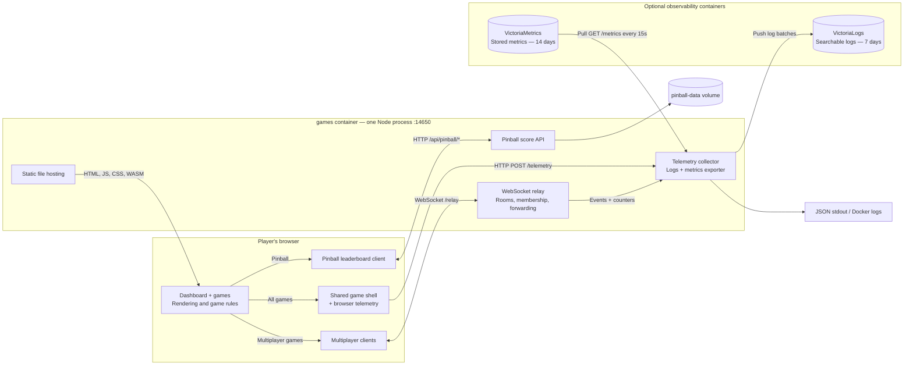
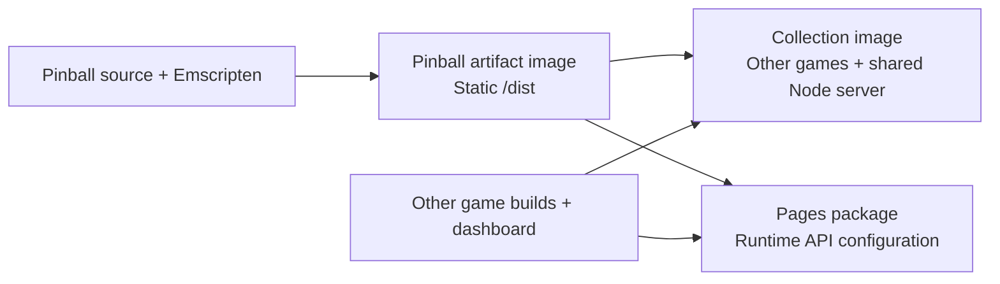

# Repository Architecture

AI Games is a collection of browser games backed by one shared Node service. In the default [Compose deployment](../docker-compose.yml), that service serves the dashboard and games, runs the multiplayer relay, and collects telemetry—all on port **14650**.



Games connect to the service as follows:

| Games | Integration |
| --- | --- |
| Multiplayer Lab (`games/playground/`), Dots & Boxes (`games/dots-and-boxes/`) | Use [`packages/multiplayer`](../packages/multiplayer/) for connections, rooms, readiness, reconnects and latency measurements. |
| Sea Strike (`games/sea-strike/`) | Uses its own [`useRelay`](../games/sea-strike/src/composables/useRelay.ts) client and the relay's legacy two-player protocol. See its [game architecture](02-ARCHITECTURE.md). |
| Space Cadet Pinball (`games/pinball/`) | Runs its WASM engine in the browser; uses the HTTP API for persistent leaderboard scores. |
| Minesweeper (`games/minesweeper/`), Snow Drift (`games/snow-drift/`) | Run locally in the browser and use the shared shell for telemetry. |

**The relay handles transport; each game owns its rules and synchronization.** Modern rooms are isolated by `appId` and room ID. Rooms, membership and relay counters live in memory and reset on restart. Pinball's top-ten leaderboard persists in `/data/pinball-scores.json`, backed by the Compose volume. The shared server is wired in [`services/game-server/src/server.ts`](../services/game-server/src/server.ts); see the [multiplayer reference](MULTIPLAYER.md) for protocol details.

**Observability is shared across all games and the dashboard.** [`shared/game-shell.js`](../shared/game-shell.js) initializes [`shared/telemetry.js`](../shared/telemetry.js) for page loads, load duration, browser errors and custom game logs. Browser telemetry uses separate HTTP requests from multiplayer messages. [`services/game-server/src/observability.ts`](../services/game-server/src/observability.ts) combines browser and server logs into structured JSON identified by `appId`, source, instance and environment, and exposes Prometheus-format metrics. Browser telemetry delivery is best effort.

The base Compose file runs only `games`; [`docker-compose.observability.yml`](../docker-compose.observability.yml) adds VictoriaLogs and VictoriaMetrics. The relay pushes logs to VictoriaLogs; VictoriaMetrics pulls metrics using [`observability/prometheus.yml`](../observability/prometheus.yml). Without the overlay, logs still appear on stdout and `/metrics` remains available. See the [observability setup](../README.md#observability) for configuration.

Sources are grouped by responsibility:

```text
games/<id>/              Game UI, rules, assets and optional native engine
services/game-server/    Shared HTTP hosting, relay, scores and observability
packages/multiplayer/    Framework-independent multiplayer client
shared/                 Browser shell and telemetry
scripts/                Collection build and validation
observability/          Optional log and metrics service configuration
games.json              Catalogue: game identity, source and public route
index.html              Collection dashboard
```

[`games.json`](../games.json) drives [`scripts/build-collection.mjs`](../scripts/build-collection.mjs): built games supply static `dist/` outputs; plain browser games supply their source files. Source folders and public routes are independent, so Snow Drift still uses `/snow_drift/`.

Pinball has an independent [game image build](../games/pinball/Dockerfile). Its artifact image contains static files at `/dist`; the collection copies them during its build, so Pinball adds no runtime container:



One reusable [game image workflow](../.github/workflows/game-images.yml) discovers every `games/*/Dockerfile`, fingerprints its committed game and shared inputs plus build arguments, and compares that fingerprint with the current GHCR `latest` image. It reuses matching artifacts, builds changed or missing versions in parallel, and returns a map of immutable image digests to both hosting workflows. Per-game locks coordinate concurrent callers; only the current default-branch HEAD updates artifact `latest` tags. Future games need no separate workflow. Optional `image-build.json` files declare extra inputs and configurable arguments.

Pages automatically extracts registered artifact games and skips their source builds. The root [Dockerfile](../Dockerfile) copies Pinball's artifact and retains cached stages for other compiled games; consuming another artifact there requires adding its image argument and output copy. A manual forced game-image run refreshes all artifacts, including base images or external resources; the collection or Pages must then be rebuilt to include them. [Local Compose](../docker-compose.local.yml) selects Pinball's artifact with `PINBALL_IMAGE` or `PINBALL_IMAGE_TAG`; [Adding a game](ADDING_A_GAME.md) describes the build contracts.

Sea Strike's historical phase and ticket documents use `app/` and `relay/`; these now map to `games/sea-strike/` and `services/game-server/` respectively.
